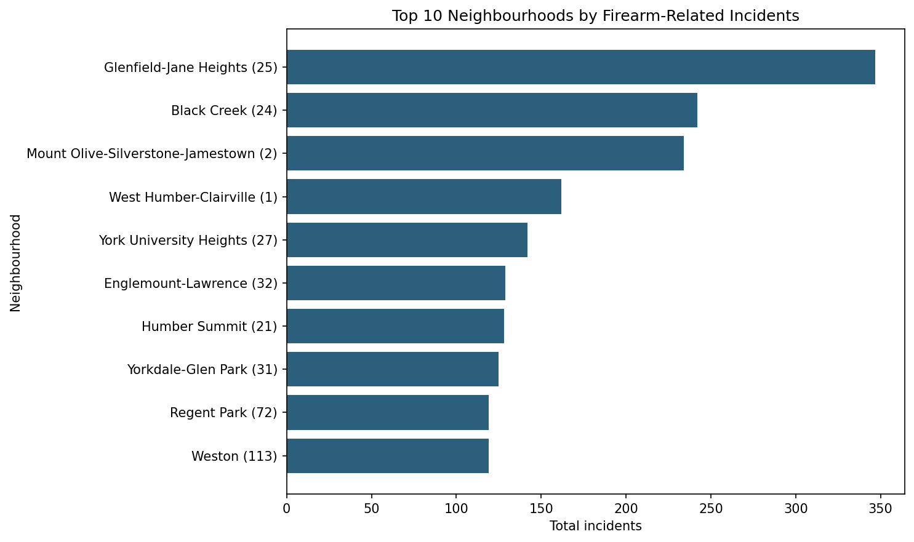
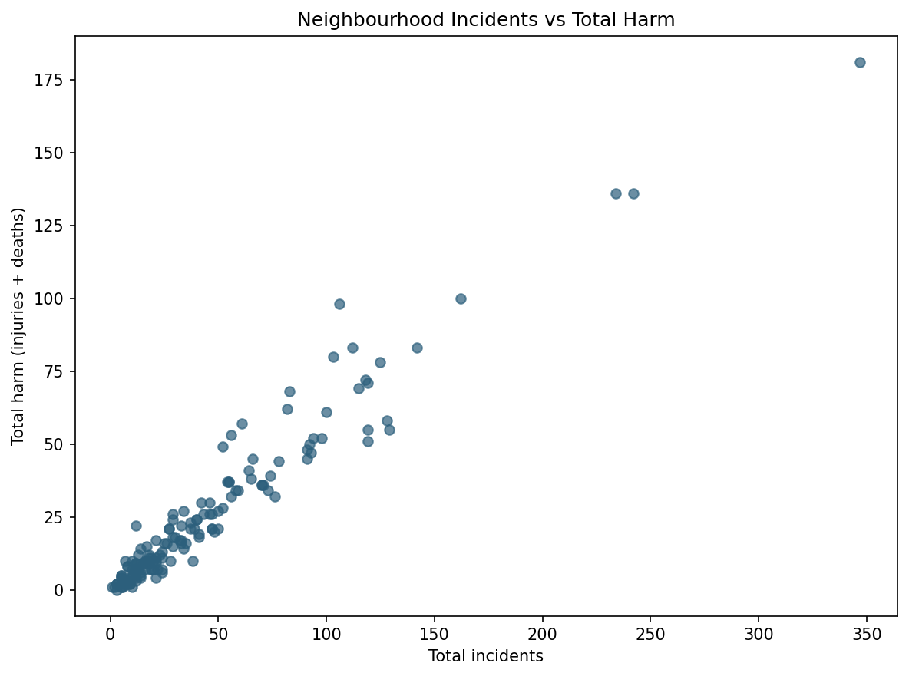

# Toronto Firearm Incident Analysis

CCT416 project analyzing Toronto Police Service open data on shootings and firearm discharges.

**Stack:** Python · Pandas · Matplotlib · DuckDB (SQL) · Jupyter

**Repo:** [github.com/5781mahmood/cct416-firearm-analysis](https://github.com/5781mahmood/cct416-firearm-analysis)

---

## Research question

Do neighbourhoods with the **most firearm-related incidents** also have the **most harm** (injuries + deaths), or does “high risk” change when we switch from counting events to measuring severity?

---

## Data source

- **Provider:** Toronto Police Service Public Safety Data Portal  
- **Dataset:** [Shooting and Firearm Discharges Open Data](https://data.torontopolice.on.ca/datasets/TorontoPS::shooting-and-firearm-discharges-open-data/about)  
- **Local file:** `shooting_firearm_discharges.csv`  
- **Geography used:** `NEIGHBOURHOOD_158` (City of Toronto 158 neighbourhoods)  
- **Period in this file (after cleaning):** 2004–2026  

See [`DATA_DICTIONARY.md`](DATA_DICTIONARY.md) for field definitions.

---

## Method

1. **Load & profile** the CSV (shape, dtypes, missingness).  
2. **Clean:** coerce numeric fields, drop incomplete rows, remove `NSA` (Not Specified Area) geography so neighbourhood rankings are not distorted.  
3. **Engineer** `total_harm = INJURIES + DEATH`.  
4. **Pandas aggregations:** neighbourhood / year / event-type summaries; Top-10 by incidents, total harm, and harm-per-incident.  
5. **Visualize** and save PNGs to [`charts/`](charts/).  
6. **DuckDB SQL:** register the cleaned table, rebuild the same Top-10 rankings with `GROUP BY` / `ORDER BY` / `LIMIT`, then `JOIN` two CTEs to list neighbourhoods that appear in both Top-10 lists.  
7. **Validate** that Pandas and SQL Top-10 incident rankings match before reporting findings.

---

## Key findings (from the notebook run — not invented)

After cleaning (**6,759** incidents; **70** rows removed, mostly `NSA`):

| Metric | Value |
|--------|------:|
| Injuries | 3,114 |
| Deaths | 788 |
| Total harm (injuries + deaths) | **3,902** |
| Correlation: neighbourhood incidents vs total harm | **0.968** |
| Neighbourhoods in **both** Top-10 (incidents & harm) | **6** |

1. **Volume and total harm move together at the neighbourhood level** (correlation **0.968**). Six places appear in both Top-10 lists: Black Creek, Glenfield-Jane Heights, West Humber-Clairville, Mount Olive-Silverstone-Jamestown, Yorkdale-Glen Park, York University Heights. Glenfield-Jane Heights leads raw volume at **347** incidents.  

2. **The ranking flips under harm-per-incident.** Playter Estates-Danforth ranks first on rate (**1.83** harm per incident) but on only **12** incidents — a reminder that rate metrics are sensitive to small counts.  

3. **Harm is concentrated in one event type.** Firearm discharges: **3,600** incidents with **0** recorded injuries/deaths in this file. Shootings: **3,159** incidents carrying **all** 3,114 injuries and 788 deaths.

These three points are the ones to put on a resume bullet or LinkedIn post.

---

## Charts

| File | What it shows |
|------|----------------|
| [`charts/top10_incidents.png`](charts/top10_incidents.png) | Top 10 neighbourhoods by incident count |
| [`charts/top10_harm.png`](charts/top10_harm.png) | Top 10 by total harm |
| [`charts/top10_harm_rate.png`](charts/top10_harm_rate.png) | Top 10 by harm per incident |
| [`charts/incidents_vs_harm_scatter.png`](charts/incidents_vs_harm_scatter.png) | Neighbourhood incidents vs harm |
| [`charts/incidents_by_year.png`](charts/incidents_by_year.png) | Incidents over time |
| [`charts/harm_by_year.png`](charts/harm_by_year.png) | Harm over time |
| [`charts/incidents_by_event_type.png`](charts/incidents_by_event_type.png) | Shootings vs firearm discharges |





---

## How to run

```bash
pip install -r requirements.txt
jupyter notebook Toronto_Firearm_Analysis_Code.ipynb
```

Run all cells. Charts rewrite into `charts/`. Summary CSVs (`neighbourhood_summary.csv`, etc.) are regenerable and gitignored.

---

## Project layout

```
├── Toronto_Firearm_Analysis_Code.ipynb   # full analysis + teaching notes + SQL
├── shooting_firearm_discharges.csv       # source data
├── charts/                               # PNG outputs for portfolio / README
├── DATA_DICTIONARY.md                    # field definitions
├── requirements.txt
└── README.md
```

---

## Limitations

- Administrative open data — reporting rules and definitions can change across years.  
- Dropping `NSA` improves neighbourhood ranking quality but excludes incidents with unclear geography.  
- Harm-per-incident on small counts is unstable.  
- Correlation is descriptive, not causal.  
- Results depend on choosing `NEIGHBOURHOOD_158` (an alternative 140 geography also exists in the file).

---

## Skills demonstrated (interview / resume)

- Data cleaning & metric design on real public-safety open data  
- Exploratory analysis with **Pandas** (`groupby`, ranking, correlation)  
- Analytical **SQL** in **DuckDB** (`GROUP BY`, `ORDER BY`, `LIMIT`, CTE + `INNER JOIN`) with Pandas cross-check  
- Clear visualization + reproducible chart exports  
- Transparent limitations and documentation
