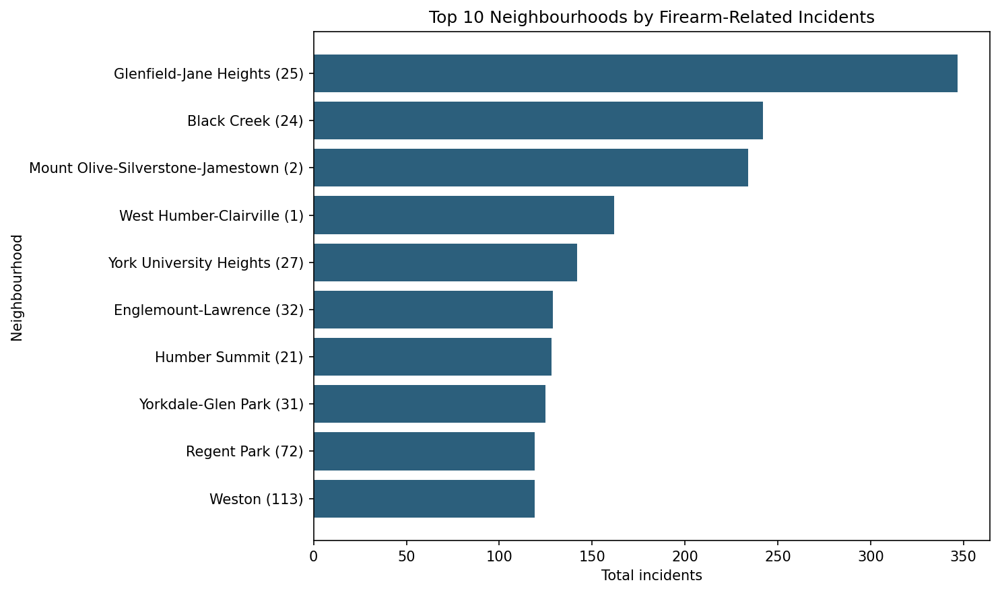
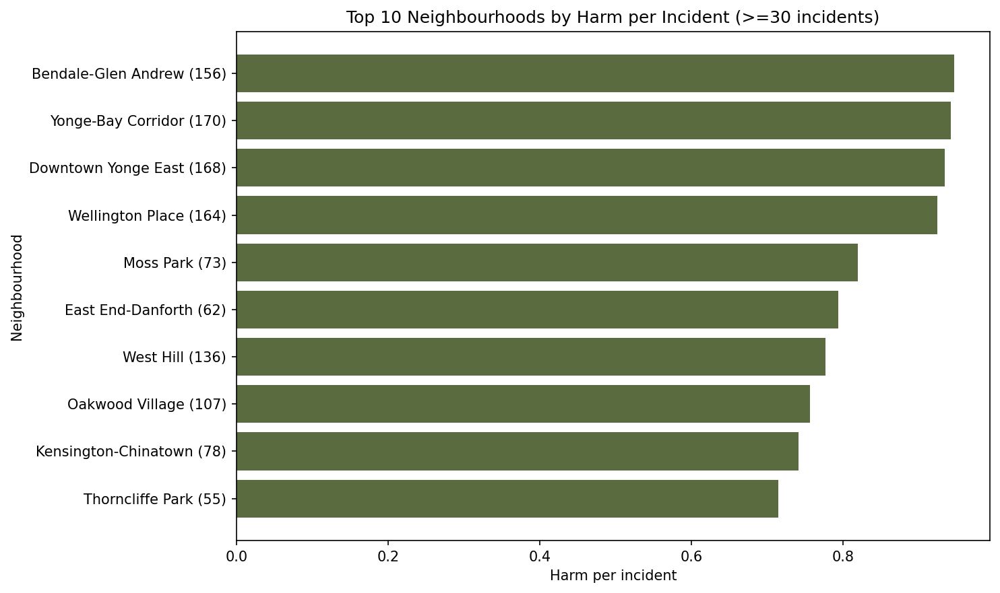
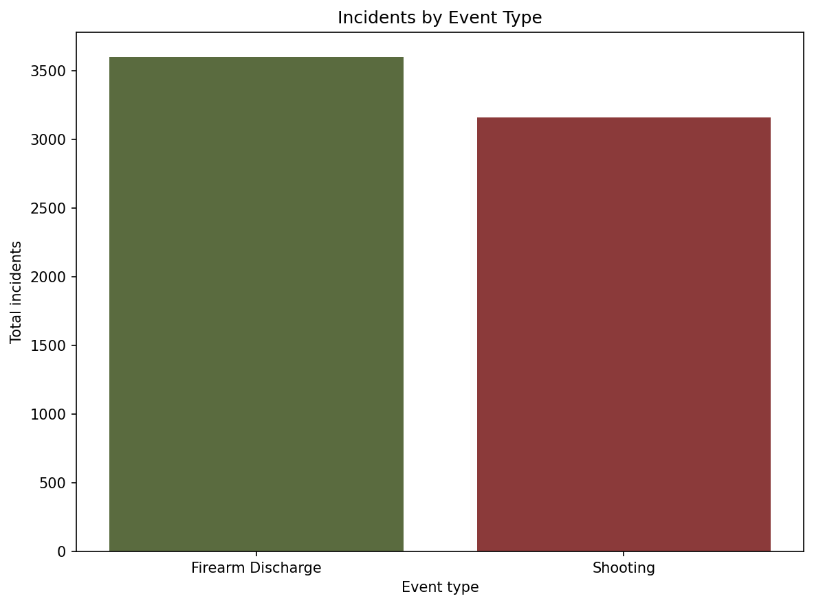

# Toronto Firearm Incident Analysis

Mahmood Sultan - CCT416, University of Toronto Mississauga, May-Jun 2026 (solo)

Analysis of Toronto Police Service open data on shootings and firearm discharges.

**Stack:** Python · Pandas · Matplotlib · DuckDB (SQL) · Jupyter

**Repository:** [github.com/5781mahmood/cct416-firearm-analysis](https://github.com/5781mahmood/cct416-firearm-analysis)

## Research question

Do neighbourhoods with the most firearm-related incidents also have the most harm (injuries + deaths), or does the ranking change when severity is measured instead of event counts?

## Data source

- **Dataset:** [Shooting and Firearm Discharges](https://data.torontopolice.on.ca/datasets/TorontoPS::shooting-and-firearm-discharges-open-data/about), Toronto Police Service Public Safety Data Portal
- **File:** `shooting_firearm_discharges.csv`
- **Geography:** `NEIGHBOURHOOD_158` (City of Toronto 158 neighbourhoods)
- **Coverage:** incidents dated January 1, 2004 to March 30, 2026
- **Licence:** [Open Government Licence - Ontario](https://www.tps.ca/data-maps/resources/licence/)

Contains information licensed under the Open Government Licence - Ontario.

Field definitions are in [`DATA_DICTIONARY.md`](DATA_DICTIONARY.md).

## Method

1. Load the CSV and check shape, dtypes, and missing values.
2. Coerce numeric fields, drop incomplete rows, and remove `NSA` (Not Specified Area) so those rows are not treated as a neighbourhood.
3. Define `total_harm = INJURIES + DEATH`.
4. Aggregate in Pandas by neighbourhood, year, and event type. Rank the top 10 by incidents and by total harm for all neighbourhoods. Rank harm per incident only for neighbourhoods with at least `MIN_INCIDENTS = 30` incidents.
5. Save the figures to [`charts/`](charts/). Yearly charts keep 2026 and mark it as a partial year (January 1 to March 30).
6. Register the cleaned table in DuckDB and rebuild the rankings with `GROUP BY`, `ORDER BY`, and `LIMIT`. The harm-per-incident SQL query adds `HAVING COUNT(*) >= 30`. Join the two top-10 lists with a `JOIN` of two common table expressions.
7. Check the Pandas rankings against the SQL rankings. Eight neighbourhoods sit clearly above a three-way tie at 119 incidents (Malvern East, Regent Park, and Weston), so the last two names in a top 10 depend on how that tie is broken. The count on each of those rows is 119.

## Key findings

After cleaning: **6,759** incidents (**70** rows removed, mostly `NSA`).

| Metric | Value |
|--------|------:|
| Injuries | 3,114 |
| Deaths | 788 |
| Total harm (injuries + deaths) | 3,902 |
| Correlation: neighbourhood incidents vs total harm | 0.968 |
| Neighbourhoods in both top 10 lists (incidents and harm) | 6 |

1. Neighbourhood incident counts and total harm move together (correlation **0.968**). Six neighbourhoods are in both top-10 lists: Black Creek, Glenfield-Jane Heights, West Humber-Clairville, Mount Olive-Silverstone-Jamestown, Yorkdale-Glen Park, and York University Heights. Glenfield-Jane Heights has the most incidents (**347**).
2. Harm per incident is ranked only for neighbourhoods with at least 30 incidents (**71** of **158**; **87** fall below the threshold). Bendale-Glen Andrew leads that ranking at **0.946** harm per incident on **56** incidents. That list differs from the volume ranking.

## Data notes

- In this dataset, injuries and deaths are recorded under the "Shooting" event type by definition. Firearm Discharge rows (**3,600**) show 0 injuries and 0 deaths for that reason. Shootings account for **3,159** incidents and all recorded injuries and deaths in the file.
- 2026 is a partial year in the yearly charts (January 1 to March 30). It is kept on the charts and labeled as partial, not dropped.

## Charts



*Top 10 neighbourhoods by incident count. Glenfield-Jane Heights is first, at 347 incidents.*



*Top 10 neighbourhoods by harm per incident among those with at least 30 incidents. Bendale-Glen Andrew is first, at 0.946 harm per incident on 56 incidents.*



*Incidents by event type. Firearm discharges (3,600) outnumber shootings (3,159). Recorded injuries and deaths sit under the Shooting rows by data definition.*

Other figures in `charts/`: total harm, the incidents-versus-harm scatter, and the yearly series (2026 marked as a partial year).

## How to run

```bash
pip install -r requirements.txt
jupyter notebook Toronto_Firearm_Analysis_Code.ipynb
```

Run all cells. Figures are rewritten in `charts/`. The summary CSVs are regenerated on each run and are listed in `.gitignore`.

## Project layout

```
├── Toronto_Firearm_Analysis_Code.ipynb
├── shooting_firearm_discharges.csv
├── charts/
├── DATA_DICTIONARY.md
├── requirements.txt
└── README.md
```

## Limitations

- The source is administrative open data. Reporting rules and definitions can change across years.
- Dropping `NSA` excludes incidents with no neighbourhood label.
- Harm per incident is ranked only for neighbourhoods with at least 30 incidents. Below that threshold the rate is unstable.
- The correlation describes neighbourhood totals. It is not a causal estimate.
- Rankings use `NEIGHBOURHOOD_158`. The file also contains the 140-neighbourhood geography.
